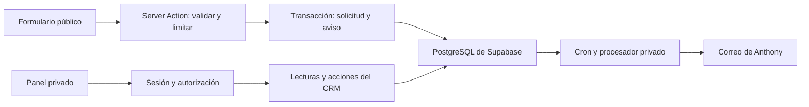

# Plan maestro — Flores Systems

**Estado:** borrador revisado y editable.  
**Revisión:** 15 de octubre de 2026.  
**Prioridad:** formulario de cotización → aviso por correo → mini CRM privado.  
**Alcance de esta revisión:** documentación; el proyecto continúa como landing estática.

## Documentos de trabajo

| Documento | Contenido |
| --- | --- |
| [Plan frontend](PLAN_FRONTEND.md) | Landing, demos, formulario, pantallas del panel, accesibilidad y animaciones |
| [Plan backend](PLAN_BACKEND.md) | Supabase, datos, Server Actions, autenticación, permisos, avisos y operación |
| [Versiones y compatibilidad](VERSIONES_TECNOLOGIAS.md) | Últimas estables consultadas, versiones propuestas y motivos de las excepciones |
| Este plan maestro | Decisiones de producto, contrato compartido, dependencias, costos y ajustes |

La separación es por responsabilidad. Se mantiene una sola aplicación Next.js: sus Server Actions, Route Handlers y acceso a datos forman parte del backend aunque vivan en el mismo repositorio que las pantallas. Supabase aporta la base de datos, Auth y ejecución programada de avisos.

## Resultado de la revisión

| Punto revisado | Resultado |
| --- | --- |
| Tus incorporaciones | Se conservan rubros prioritarios, tres demos, Open Graph, agenda, origen de contactos, analítica, nombre público y revisión de privacidad |
| Versiones | Se separa “última estable disponible” de “base propuesta”; la tabla anterior no representaba todas las últimas versiones |
| Espera de 14 días | Se conserva para actualizaciones ordinarias y se añade una excepción explícita para correcciones de seguridad |
| Next.js | Se propone 16.4.1 con configuración ESLint de la misma versión; la publicación oficial incluye correcciones críticas. [Release oficial](https://github.com/vercel/next.js/releases/tag/v16.4.1) |
| TypeScript y ESLint | Se mantienen las ramas compatibles con los plugins elegidos; ver las restricciones declaradas en la matriz |
| Demos | Las tres demos no están en los archivos actuales del repositorio: falta inventariar su fuente y alcance antes de estimarlas |
| Enlaces externos de demos | Comprobar acceso sin sesión; no asumir que todos los enlaces de claude.ai son privados |
| Agenda y WhatsApp directo | Un clic no crea una solicitud por sí solo; registrar el contacto manualmente o definir una integración posterior |
| Analítica | Separar clic, envío intentado y solicitud realmente guardada; medir sin incluir datos personales en los eventos |
| PostgreSQL | La última versión del proyecto upstream no implica que esa versión esté disponible en Supabase |
| Fechas | Se conserva el historial previo; las versiones tienen fecha de consulta y fuentes verificables |

## 1. Objetivo y decisiones iniciales

Construir una landing que convierta visitas en solicitudes guardadas y un panel privado para Anthony. El público inicial son pequeños negocios: veterinarias, spas, colegios, tiendas de ropa y negocios que necesitan sistemas administrativos. Los primeros rubros a priorizar son los que ya tienen demo y prospección activa: veterinarias, restaurantes, tiendas de abarrotes y bodegas, y mercados o puestos.

| Decisión | Propuesta inicial | Ajuste pendiente |
| --- | --- | --- |
| Aviso de nueva solicitud | Correo primero; WhatsApp automático después | Confirmar canal inicial |
| Destinatario del aviso | flores.anthony.489@gmail.com | Cambiar si corresponde |
| Contacto directo público | WhatsApp +51 986132628 | Confirmar continuidad |
| Usuarios del panel | Una sola cuenta administradora | Sin equipo inicialmente |
| Acceso al panel | Correo y contraseña con Supabase Auth | Crear la cuenta de Anthony |
| Diseño | Conservar la landing actual | Revisar textos al migrar |
| Hosting | Vercel Pro como referencia sencilla | Comparar con hosting Node.js si el presupuesto exige reducir costos |
| Base de datos inicial | Supabase Free durante desarrollo y piloto | Decidir continuidad de producción |
| Idioma y moneda | Español; presupuestos en PEN | Confirmar rangos de presupuesto |
| Dominio y remitente | Dominio propio por definir | Necesarios para configurar el correo de producción |

Los rubros prioritarios de esta etapa son veterinarias, restaurantes, tiendas de abarrotes y bodegas, y mercados o puestos. La consistencia del nombre público debe revisarse también en las demos y mensajes comerciales.

## 2. Contrato compartido del formulario y el CRM

Esta sección es la referencia común para ambos planes. Al implementar, los esquemas y tipos compartidos se ubicarán en `src/lib/contracts/`; las credenciales y funciones privilegiadas quedan fuera de esa carpeta compartida.

**Campos propuestos**

| Campo | Requerido | Comportamiento |
| --- | --- | --- |
| Nombre del contacto | Sí | Máximo 80 caracteres |
| Nombre del negocio | Sí | Máximo 120 caracteres |
| Tipo de negocio | Sí | Veterinaria, restaurante, tienda o bodega, mercado o puesto, spa, colegio, ropa u otro |
| Servicio de interés | Sí | Sitio web, sistema administrativo, ambos o necesito orientación |
| Descripción de la necesidad | Sí | Entre 10 y 2.000 caracteres |
| Canal preferido | Sí | Correo o WhatsApp |
| Correo electrónico | Condicional | Obligatorio si elige correo |
| Teléfono con código de país | Condicional | Obligatorio si elige WhatsApp; normalizar formato |
| Presupuesto aproximado | No | Rangos por definir y “Aún no lo sé” |
| Plazo deseado | No | Opciones simples, sin prometer disponibilidad |
| Autorización para contactar por esta solicitud | Sí | Registrar fecha y versión del aviso |

Siempre debe existir al menos una vía de contacto válida. La autorización para esta solicitud no implica suscripción a campañas.

**Datos controlados por el servidor:** identificador, fecha, estado inicial `nuevo`, origen `formulario_web`, versión vigente del aviso y destinatario de las notificaciones. Los valores de catálogo enviados por el cliente se validan contra listas permitidas. El consentimiento se recoge del formulario y su fecha se asigna en el servidor.

**Resultado del envío:** devolver confirmación y referencia de la solicitud cuando la transacción haya terminado. Los errores deben distinguir datos inválidos, exceso de envíos y fallo temporal. No devolver notas, datos de otros contactos ni errores internos de PostgreSQL.

**Reintentos:** un mismo envío lógico conserva su clave de idempotencia; una nueva oportunidad genera otra. Si la misma clave llega con contenido distinto, devolver conflicto sin sustituir la solicitud original.

**Estados comerciales y cierre**

| Estado | Significado propuesto |
| --- | --- |
| Nuevo | Solicitud recibida, pendiente de primer contacto |
| En conversación | Ya existe diálogo para entender el proyecto |
| Cotizado | Propuesta enviada; registrar fecha y monto opcional |
| Cerrado | Oportunidad finalizada; indicar ganado, perdido o desistido |

Guardar un motivo opcional de cierre y permitir reabrir una solicitud conservando el historial. El estado describe la oportunidad comercial, no el avance del desarrollo del proyecto.

Abrir WhatsApp o correo no cambia el estado automáticamente: Anthony registra la conversación cuando realmente ocurrió.

Los identificadores técnicos propuestos son `nuevo`, `en_conversacion`, `cotizado` y `cerrado`. El resultado del cierre es `ganado`, `perdido` o `desistido`; al reabrir se limpia el resultado vigente y se conserva su registro histórico.

**Origen del contacto:** formulario web, WhatsApp, correo, prospección u otro. Anthony elige el origen al crear contactos manuales. Las etiquetas de campañas son opcionales, limitadas y validadas; nunca se usan para autorizar operaciones.

## 3. Fase común 0 — Cerrar decisiones y preparar accesos

**Objetivo:** evitar que dominio, correo o cuentas detengan la implementación.

- [ ] Ajustar este documento y fijar el alcance de las primeras entregas.
- [ ] Elegir el dominio del sitio y confirmar acceso a su DNS.
- [ ] Preparar cuentas de Supabase, proveedor de correo y hosting.
- [ ] Confirmar el destinatario de los avisos y la cuenta administradora.
- [ ] Definir campos del formulario, rangos de presupuesto y significado de “cerrado”.
- [ ] Definir cómo separar datos de desarrollo y producción.
- [ ] Establecer un presupuesto mensual máximo.
- [ ] Decidir el nombre público con el que te presentas y usarlo igual en la web, los mensajes de WhatsApp y las demos.
- [ ] Revisar los requisitos de la Ley N.° 29733 de protección de datos personales para el aviso de privacidad y la conservación de contactos.

**Criterio de cierre:** decisiones anotadas y accesos disponibles. Las credenciales se guardarán en variables de entorno o gestores de secretos, nunca en este documento.

La revisión de privacidad debe contemplar la Ley N.° 29733 y su reglamento, incluido el D. S. N.° 016-2024-JUS. Concretar aviso, finalidades y conservación antes de publicar. [Norma oficial](https://www.gob.pe/institucion/smv/normas-legales/6426760-016-2024-jus).

## 4. Integración entre frontend y backend

| Contrato | Frontend | Backend |
| --- | --- | --- |
| Formulario | Capturar campos, mostrar errores y conservar el envío lógico | Validar, limitar, guardar atómicamente y devolver confirmación |
| Inicio de sesión | Formulario, recuperación y estados de sesión | Supabase Auth, cookies y comprobación de administrador |
| Lista y detalle | Filtros, navegación, carga y estado vacío | Consulta paginada y autorizada; sin caché compartida de datos privados |
| Seguimiento | Interfaz de notas, estados, monto y próxima fecha | Persistencia, validación e historial atómico |
| Avisos | Mostrar estado y ofrecer reintento al administrador | Cola persistente, proveedor, reintentos y bloqueo de trabajos |
| Analítica | Emitir eventos sin datos del contacto | Contar solicitudes confirmadas; aislar datos del CRM |

## 5. Orden de ejecución y dependencias

Los identificadores FE y BE corresponden a los planes separados.

| Entrega | Frontend | Backend | Condición de cierre |
| --- | --- | --- | --- |
| Acuerdos | Fase común 0 | Fase común 0 | Dominio, canales, campos y alcance definidos |
| Base | FE-0 | BE-0 | Proyecto Next.js y entornos preparados |
| Preparar captación | Formulario de FE-2 puede diseñarse con datos ficticios | BE-1 y BE-2 | Guardado y aviso verificables en pruebas |
| Primera entrega pública | FE-0 + landing básica de FE-1 + FE-2 | BE-0 a BE-2 + controles aplicables de BE-4 | Solicitud guardada y correo; revisión móvil y dominio |
| Mini CRM | FE-3 | BE-3 | Acceso exclusivo de Anthony, estados, notas y seguimiento |
| Operación completa | FE-4 | BE-4 | Respaldo, recuperación, métricas y monitoreo |
| Demos y visuales | Completar demos de FE-1 y órbitas de FE-5 | Sin acceso a datos reales para las demos | Experiencias legibles y publicadas en rutas propias |
| Aviso adicional | Indicadores necesarios en FE-3 | BE-5 | WhatsApp automático con proveedor y permisos definidos |

Antes de terminar el panel, Anthony puede consultar solicitudes desde Supabase y recibirlas por correo. Las demos pueden adelantarse si sus fuentes están disponibles, pero su reconstrucción no bloquea el formulario.

## 6. Esfuerzo orientativo y alcance pendiente

| Trabajo | Estimación de trabajo efectivo |
| --- | --- |
| Decisiones comunes | Medio día |
| Migrar landing y base técnica | 1–2 días |
| Formulario, guardado y correo integrados | 2–3 días |
| Mini CRM integrado | 2–4 días |
| Publicación y operación | 1–2 días |
| Órbitas y revisión del marquee | 1–2 días |
| Tres demos interactivas | Reestimar tras revisar fuentes; no incluidas en los 1–2 días de migración |
| Agenda por enlace y analítica | Ajustar según proveedor y alcance; no presupuestar sincronización automática |
| WhatsApp automático | Reestimar al elegir proveedor |

Son estimaciones del trabajo integrado de una persona, no sumas de un presupuesto frontend y otro backend. Las comprobaciones, dependencias técnicas y esperas de proveedores pueden modificar los rangos.

## 7. Costos y estrategia de menor gasto

Precios revisados el 15 de octubre de 2026, expresados en USD. Confirmarlos antes de contratar; no incluyen desarrollo, dominio, impuestos ni consumo adicional.

| Servicio | Referencia actual | Decisión propuesta |
| --- | --- | --- |
| Next.js | Framework sin tarifa propia de hosting | Un solo proyecto para landing y panel |
| Supabase Free | USD 0; 500 MB de base de datos; posible pausa tras una semana de inactividad | Desarrollo y piloto; evaluar el riesgo de pausa antes de recibir clientes |
| Supabase Pro | Desde USD 25/mes | Considerarlo cuando se requiera mayor continuidad y respaldo gestionado |
| Resend Free | USD 0; 3.000 correos/mes y 100/día | Comenzar con avisos internos |
| Vercel Pro | Precio base publicado de USD 20/mes | Referencia de hosting comercial; controlar consumo |
| Dominio | Depende del nombre y registrador | Cotizar antes de configurar remitente |
| WhatsApp API | Depende de mercado, categoría y proveedor | Fase opcional; no contratar al inicio |

Fuentes de los importes: [Supabase](https://supabase.com/pricing), [Resend](https://resend.com/pricing), [Vercel](https://vercel.com/pricing).

Vercel Hobby restringe su uso a proyectos personales no comerciales; para esta landing comercial, presupuestar un plan permitido o comparar otro hosting compatible con Next.js. [Condiciones de Hobby](https://vercel.com/docs/plans/hobby).

Resend necesita un dominio propio verificado para el remitente de producción. El Gmail de Anthony puede recibir los avisos, pero no debe usarse como dominio remitente en Resend. [Dominios verificados](https://resend.com/docs/dashboard/domains/introduction).

**Escenario de referencia:** Vercel Pro + Supabase Free + Resend Free tiene una base aproximada de USD 20/mes; con Supabase Pro, aproximadamente USD 45/mes, antes de los conceptos adicionales anteriores. Es una suma orientativa de precios base, no una garantía de factura ni de disponibilidad.

Para reducir gasto inicial: usar un solo proyecto, avisar primero por correo, aprovechar cuotas gratuitas mientras sean adecuadas y posponer adjuntos, automatizaciones de WhatsApp y funciones comerciales avanzadas. Si USD 20/mes excede el presupuesto, comparar hosting Node.js autorizado para uso comercial antes de decidir; el costo de mantenimiento también cuenta.

El enlace a Cal.com y el proveedor de analítica todavía requieren confirmar plan, condiciones y costo. No se presupuestó autohospedar Cal.com ni contratar Redis: son decisiones distintas de agregar un enlace de agenda o un límite de envíos en PostgreSQL.

## 8. Ajustes para la siguiente revisión

Editar las respuestas y marcar las decisiones cerradas.

- [ ] **Canal inicial de avisos:** correo / WhatsApp / ambos. Propuesta: correo.
- [ ] **Dominio elegido:** ____________________
- [ ] **Hosting y presupuesto mensual máximo:** ____________________
- [ ] **Cuenta administradora:** ____________________
- [ ] **Rangos de presupuesto del formulario:** ____________________
- [ ] **Campos que deseas agregar o quitar:** ____________________
- [ ] **Resultado al cerrar oportunidades:** ganado / perdido / desistido. Ajustes: ____________________
- [ ] **Tiempo objetivo para responder a un contacto:** ____________________
- [ ] **Plazo de conservación de datos:** ____________________
- [ ] **Prioridad de las órbitas del logo después del CRM:** ____________________
- [ ] **Necesidad real de WhatsApp automático:** ____________________
- [ ] **Stack tecnológico:** confirmar o ajustar VERSIONES_TECNOLOGIAS.md. Ajustes: ____________________
- [ ] **Nombre público:** ____________________
- [ ] **Rubros que se muestran primero en la web:** ____________________
- [ ] **Mostrar precios “desde” en la web:** sí / no. Ajustes: ____________________
- [ ] **Fuentes de las demos de tienda, veterinaria y restaurante:** ____________________
- [ ] **URL de agenda y creación automática de contactos:** enlace manual / integración posterior. Ajustes: ____________________
- [ ] **Analítica y datos que se medirán:** ____________________
- [ ] **Política de versiones:** mantener 14 días para cambios ordinarios y excepción de seguridad. Ajustes: ____________________
- [ ] **Gestor de paquetes:** npm / pnpm. Ajustes: ____________________
- [ ] **Almacenamiento del límite de envíos:** PostgreSQL / Upstash. Ajustes: ____________________

## 9. Funciones para evaluar después

Presupuestos PDF, pagos, contratos, cuentas de clientes, seguimiento de proyectos, adjuntos, agenda automática, campañas y usuarios de equipo requieren alcance propio. El primer objetivo es que cada solicitud quede guardada y pueda atenderse con estado, notas y seguimiento.

El enlace para agendar una llamada está incluido en el alcance. La sincronización automática con agenda, la captura de contactos de WhatsApp y el seguimiento del desarrollo de proyectos permanecen como ampliaciones.

## Historial de ajustes

| Fecha | Cambio | Motivo |
| --- | --- | --- |
| 2026-10-14 | Borrador inicial por fases | Priorizar formulario y mini CRM con Next.js y Supabase |
| 2026-10-14 | Rubros prioritarios, demos como páginas del proyecto, Open Graph, enlace para agendar llamada, origen de contactos, analítica simple, Ley 29733 y nombre público | Revisión del plan |
| 2026-10-15 | Tabla de stack tecnológico en la sección 4 | Reunir en un solo lugar las tecnologías y las decisiones pendientes |
| 2026-10-15 | Versiones exactas verificadas en npm y notas de compatibilidad | Evitar sorpresas por actualizaciones o incompatibilidades |
| 2026-10-15 | Separación en planes frontend y backend; matriz de últimas versiones y compatibilidad | Conservar tus cambios, explicitar dependencias y revisar los requisitos actuales |
| 2026-10-15 | Excepción documentada a la espera de 14 días para el conjunto de actualización de Next.js | Incorporar el parche oficial de seguridad y verificar el conjunto antes de publicar |
